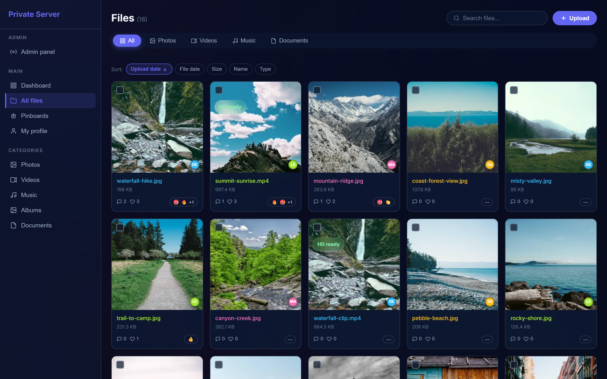
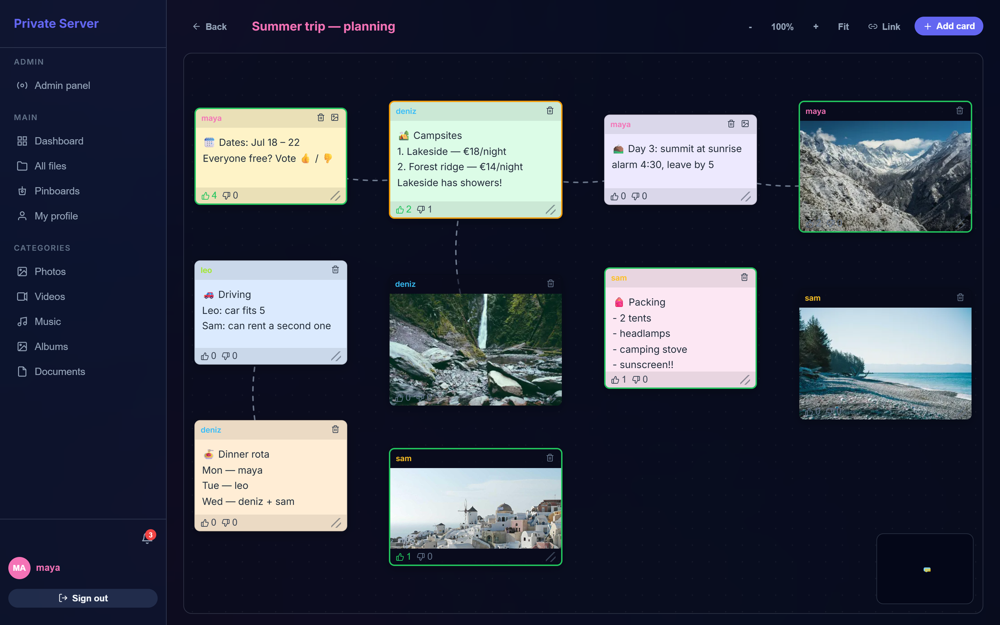

# Private Server

**Self-hosted media sharing for small groups** — families, friend groups, clubs, small teams. One Docker container gives your group a private place to upload photos, videos, music and documents, organise them into albums, talk about them, and plan things together on shared pinboards — with live updates on every device.

**Stack:** React 18 · Node.js / Express · SQLite (better-sqlite3) · Socket.IO · sharp · ffmpeg · Docker

| Media library | Shared pinboard |
| --- | --- |
|  |  |

---

## Features

**Media library**
- Multi-file drag-and-drop uploads (desktop and mobile), shared pool of files for the whole group
- Categories (photos, videos, audio, documents), search, sorting and pagination
- Image thumbnails with **sharp**; capture date read from EXIF metadata
- **Video pipeline:** ffmpeg thumbnails plus background transcoding to 1080p / 720p / 360p proxies; the original is playable immediately while proxies are generated, and the player picks a quality automatically
- Pick any video frame as the cover; blur toggle for sensitive media; rename, bulk select, bulk delete

**Albums** — create, rename, set a cover, add/remove files individually or in bulk

**Social layer**
- Emoji reactions, threaded comments with replies, comment likes, @mentions with profile cards
- Global activity feed and a personal notification centre (in-app + optional email on new uploads)

**Pinboards** — a shared, zoomable canvas for planning: note, image, video and file-reference cards; drag, resize, link cards with arrows, vote on cards; minimap and pinch-to-zoom; changes sync live to everyone viewing the board

**Group & admin**
- Invite-only sign-up with a setup key; the first account becomes admin; configurable user limit
- Profiles with avatar and colour; password reset by email
- Admin panel: manage users, reset passwords, grant admin rights, browse structured server logs
- Shared countdown widget for upcoming events; installable PWA

## Architecture

```text
Browser / PWA ──HTTPS──► Express (single container, port 3001)
                          ├─ REST API  /api/*
                          ├─ Socket.IO (live updates)
                          ├─ static React build
                          ├─ SQLite   ./data/db/media.db
                          └─ uploads  ./data/uploads/{originals,thumbnails,proxies,avatars,pinboards}
```

- **Auth:** bcrypt-hashed passwords, JWT (30 days) via `Authorization: Bearer` or `?token=` for media URLs; login and sign-up are rate-limited.
- **Permissions:** built for small, trusted groups. Files are one shared pool: every member can view, rename, blur or delete any file, while comments can only be deleted by their author. Albums are personal. Pinboards are visible to everyone and anyone can add, move or vote on cards; a card's text and image belong to its author, cards can be deleted by their author or the board owner, and only the owner can rename or delete a board.
- **Hardening:** user uploads are served with `Content-Security-Policy: sandbox`, so an uploaded SVG or HTML file can't run scripts on the app's origin; tokens in media URLs are redacted from the access logs; helmet sets the standard security headers.
- **Realtime:** sockets authenticate with their JWT before they receive anything. Broadcasts go only to authenticated sockets; per-file and per-board rooms can only be joined after auth (joins sent while connecting are queued and applied on auth).
- **Data:** schema is created on start-up (`CREATE TABLE IF NOT EXISTS`), with additive column migrations; foreign keys with `ON DELETE CASCADE`.
- **Logging:** winston with daily rotation and a total-size cap; logs are enriched with entity names for the admin log viewer.

### Realtime events

| Event | Audience | Purpose |
| --- | --- | --- |
| `server_data_updated` | all signed-in users | invalidate cached lists |
| `activity:new` | all signed-in users | live activity feed |
| `notification:new` | `user:<id>` room | personal notifications |
| `pinboard:update` | `pinboard:<id>` room | live board edits |
| `file_interactions_updated` | `file:<id>` room | reactions / comments |

### API overview

| Area | Endpoints |
| --- | --- |
| Auth | `POST /api/auth/register` · `login` · `forgot-password` · `reset-password`, `GET /verify` |
| Files | list / upload / view / thumb / download, rename, blur, set video cover, reactions, comments, bulk delete, storage stats |
| Albums | CRUD, cover, add/remove files (single and bulk) |
| Pinboards | boards CRUD, items (note / file ref / upload), links, votes, per-user viewport |
| Social | `/api/activity`, `/api/notifications`, `/api/profile` |
| Admin | `/api/admin/users`, log browsing |

## Getting started

### Docker (recommended)

```bash
cp .env.example .env        # set JWT_SECRET and SETUP_KEY at minimum
docker compose up -d --build
```

Open `http://localhost:3001`, choose **Sign up**, and enter the setup key. The first account becomes the admin; share the setup key with the people you want to invite. Data lives in `./data` (database, uploads, logs). The container binds to `127.0.0.1` — put a reverse proxy such as Caddy or nginx in front of it for HTTPS (Socket.IO needs WebSocket upgrade headers forwarded).

### Local development

Requires Node.js 20+ and ffmpeg.

```bash
# terminal 1 — API on :3001 (set JWT_SECRET and SETUP_KEY in backend/.env first)
cd backend && cp .env.example .env && npm install && npm run dev

# terminal 2 — UI on :3000, API calls proxied to :3001
cd frontend && npm install && npm start
```

ffmpeg must be on `PATH` for video thumbnails and proxies. `npm run reprocess-media` (backend) regenerates thumbnails and video proxies for existing files.

## Configuration

| Variable | Default | Description |
| --- | --- | --- |
| `JWT_SECRET` | — | **Required.** Secret for signing tokens |
| `SETUP_KEY` | — | **Required.** Invite key needed to create an account |
| `MAX_USERS` | `10` | Account limit (`0` = unlimited) |
| `ADMIN_USERNAME` | — | Optionally pin an admin by username |
| `MAX_FILE_SIZE` | `0` | Upload limit in bytes (`0` = none) |
| `APP_URL` | `http://localhost:3001` | Public URL used in emails |
| `CORS_ORIGIN` | — | Only if the UI is served from another origin |
| `SMTP_*` | — | Optional SMTP settings for reset and notification emails |

The server refuses to start without `JWT_SECRET` and `SETUP_KEY`.

## License

MIT
